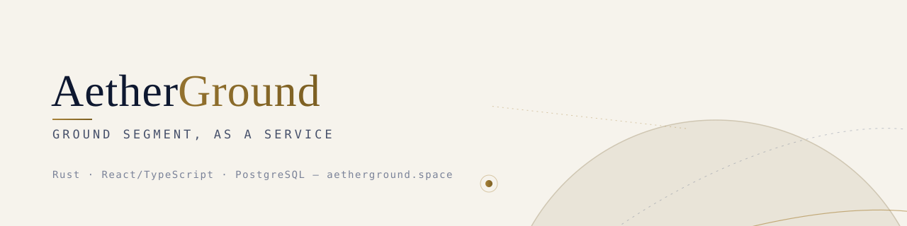

<picture>
  <source media="(prefers-color-scheme: dark)" srcset="./assets/banner-dark.svg">
  
</picture>

<p align="center">
  <a href="https://aetherground.space"><b>aetherground.space</b></a> ·
  <a href="https://aetherground.space/docs">Docs</a> ·
  <a href="#repositories">Repositories</a> ·
  <a href="#contributing">Contributing</a>
</p>

---

**AetherGround** is a ground segment platform for satellite operators: mission control, pass scheduling, telemetry and telecommand, and ground-station orchestration in one system. Operators can run it themselves or use it as a managed service.

The core is written in **Rust**, the operator console in **React + TypeScript**, and mission data lives in **PostgreSQL**.

### What it does

| | |
|---|---|
| 🛰 **Mission control** | Track spacecraft state, health, and command history from one console. |
| 📡 **Pass scheduling** | Predict passes from TLEs and allocate antenna time across a station network. |
| 📈 **Telemetry & telecommand** | Ingest, decode, store, and replay telemetry; queue and verify commands. |
| 🌐 **Station network** | Treat owned and partner ground stations as one schedulable pool. |
| 🔐 **Operator-grade security** | Role-based access, audit trails, and signed command workflows. |

### Architecture

```
  Spacecraft ──RF──▶ Ground stations ──▶ aether-core (Rust) ──▶ PostgreSQL
                                             ▲    │
                                    REST / WS│    ▼
                                      aether-console (React/TS)
```

### Repositories

| Repository | Description | Stack |
|---|---|---|
| [`aether-core`](https://github.com/aetherground/aether-core) | Scheduler, TT&C pipeline, and station orchestration service | Rust |
| [`aether-console`](https://github.com/aetherground/aether-console) | Web operator console for mission control | React · TypeScript |
| [`aether-orbit`](https://github.com/aetherground/aether-orbit) | Orbit propagation and pass prediction library | Rust |
| [`aether-docs`](https://github.com/aetherground/aether-docs) | Documentation and guides | Markdown |

### Getting started

```bash
git clone https://github.com/aetherground/aether-core
cd aether-core
docker compose up        # core service + PostgreSQL
```

The console runs at `http://localhost:3000`. Configuration and station setup are covered in the [docs](https://aetherground.space/docs).

### Contributing

Issues and pull requests are welcome. Read `CONTRIBUTING.md` in each repository before opening a PR, and report security issues privately to the maintainers rather than in public issues.

---

<sub>© AetherGround · Built in Bangkok for operators everywhere.</sub>
